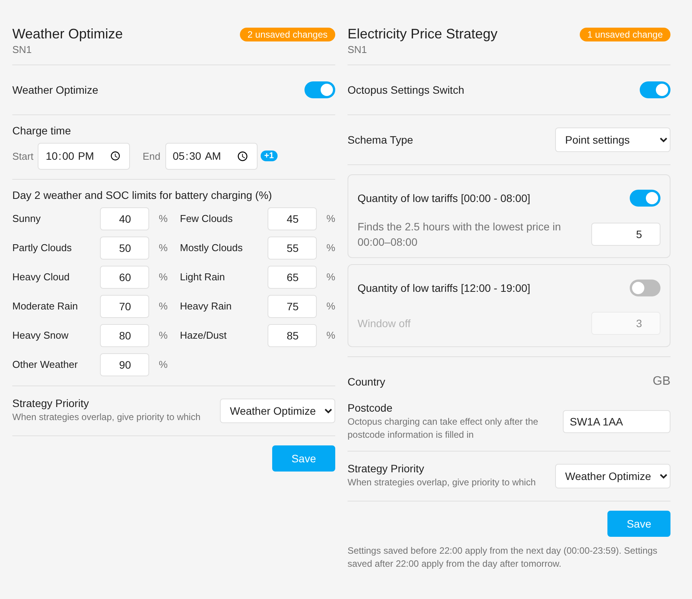

# Hanchuess Home Assistant Integration

A Home Assistant integration for the Hanchu iESS battery storage system, providing full local control and automation support via the Hanchu cloud gateway API.

This fork extends the original guoxiatech/hanchu-ess-ha integration — 
published by Hanchu (Guoxia Technology, the manufacturer) which has had few updates and open issues going unanswered — with proper automatable entities, correct API mappings, and Predbat compatibility.

## Features

### Sensors
- Battery SOC (%)
- Battery Power (W) — signed (positive = charge, negative = discharge)
- Battery Charge Power (W) — charge only derived power
- Battery Discharge Power (W) — discharge only derived power
- Battery Capacity (kWh)
- Battery pack sensors (per discovered battery serial): Battery Model (diagnostic, see [Battery model detection](#battery-model-detection)), Pack SOC (%), Pack SOH (%), Pack Voltage (V), Pack Current (A), Battery Power (W, positive = charging, negative = discharging), Design Capacity (kWh), Full Charge Capacity (Ah), Remaining Capacity (Ah), Remaining Energy (kWh, SOC × Design Capacity), Last Data Update (diagnostic, **disabled by default**: when the battery's logger last uploaded to the cloud, handy for spotting stale data), Temperature 1-N (degC, based on `numBatT`), Environment Temperature, Pack Temperature, MOS Temperature
- Battery cell sensors (per battery, when the battery reports cell data): Max Cell Voltage (V), Min Cell Voltage (V) and Cell Voltage Difference (shown in mV), plus Cell 1-N Voltage (V, based on `numBat`, **disabled by default**). A growing cell voltage difference, or one cell sitting consistently below the others, is the usual sign of an imbalanced or weak battery. Enable the individual cell sensors on a battery's device page when you want to look closer
- Grid Power (W) — signed (positive = import, negative = export)
- Grid Import Power (W) — import only derived power
- Grid Export Power (W) — export only derived power
- Load Power (W)
- PV Power (W)
- PV string sensors (per PV input the inverter reports, e.g. PV1/PV2/PV3): Power (W) and Voltage (V) from the cloud, plus Current (A) calculated as power ÷ voltage (0 A when the string has no output, e.g. at night). The cloud gives string power in kW to two decimal places, so each string is only accurate to about 10 W (a few watts at dusk can read 0 W while PV Power shows them), and the sum of the strings can differ from PV Power by a few tens of watts. Created automatically for the inputs your inverter has (if the cloud leaves them out when Home Assistant starts, for example overnight, they are added as soon as it reports them); on AC-coupled systems, where the PV inputs are usually unused, they start **disabled**, so enable them if you also have panels on the inverter's own inputs
- AC-Coupled PV Power (W)
- DG Power (W) — only available when generator support is present
- Fast Charge Time Remaining (s)
- Daily Charge/Discharge Energy (kWh)
- Daily Grid Import/Export (kWh)
- Daily Load/PV Energy (kWh)
- Daily DG Energy (kWh) — only available when generator support is present
- Monthly, Yearly and Lifetime energy (kWh) for PV, Load, Grid Import, Grid Export, Battery Charge and Battery Discharge, straight from the Hanchu cloud's statistics, see [Monthly, yearly and lifetime energy](#monthly-yearly-and-lifetime-energy)
- Device Status (online/offline/pending)
- Inverter Status: Fast Charging, Fast Discharging, Scheduled Charge, Scheduled Discharge, Charging, Discharging or Idle, see [Inverter Status Sensor](#inverter-status-sensor)
- Inverter Model, Rated AC Power (W) and Battery Power Maximum (W), diagnostic, see [Inverter model detection](#inverter-model-detection)

### Controls (fully automatable)
- **Work Mode** — Self-consumption, Backup Energy, User-defined, Off-grid
- **Charge Power Limit** (maximum set from your inverter model, see below)
- **Discharge Power Limit** (maximum set from your inverter model, see below)
- **Maximum Charge SOC** (50–100%)
- **Minimum Discharge SOC** (5–45%)
- **Grid to Battery Charge Maximum** (20–100%)
- **Charge Time Slots 1–3** — Start and End times
- **Discharge Time Slots 1–3** — Start and End times
- **Fast Charge** switch
- **Fast Discharge** switch
- **Weather Optimize** and **Octopus** (Electricity Price Strategy) settings, disabled by default, see [Weather Optimize and Octopus strategies](#weather-optimize-and-octopus-strategies)

### Settings management
Changes to all control entities above are **staged locally** and only sent to the
device when you press **Write Settings** (or call the `hanchuess.write_settings`
service). This batches all pending changes into a single `iotSet` API call,
avoiding Hanchu's rate limiter.

- **Read Settings** button — calls `iotGet` for all control keys and refreshes
  every control entity's state from the device. Also runs automatically at startup.
- **Write Settings** button — flushes all staged changes to the device in one
  `iotSet` call. Retries once on failure; creates a persistent notification if the
  retry also fails, leaving the buffer intact to retry later.
- **Pending Changes** sensor — shows the count of staged-but-unwritten
  changes (0 when clean). Useful for dashboards and automations.

### Inverter model detection

At startup the integration reads the inverter's model code (`devModel`) from the cloud and looks it up in a table of Hanchu models. This is the same mapping the Hanchu web console uses. The result is used to:

- **Show the real model name** on the device card (e.g. HESS-HY-S-5.0K) instead of "ESS Device".
- **Set the maximum for Charge and Discharge Power Limit.** The cloud's settings menu gives one 0–5000 W range for the whole single-phase range, so on its own it can't tell a 5 kW inverter from a 10 kW one.
- **Provide three diagnostic sensors:** Inverter Model, Rated AC Power and Battery Power Maximum.

Battery power and AC rating aren't always the same, which matters for Predbat:

| Inverter | Battery Power Maximum | Rated AC Power |
|---|---|---|
| Single-phase HESS-HY-S-3.0K / 3.68K / 4.0K / 5.0K / 6.0K | 5000 W | 3000 / 3680 / 4000 / 5000 / 6000 W |
| Single-phase HESS-HY-S-7.0K / 8.0K / 10.0K | Same as AC | 7000 / 8000 / 10000 W |
| Three-phase HESS-HY-T and commercial CESS-HY models | Same as AC | Model rating |

For Predbat, **Battery Power Maximum** is the value for `battery_rate_max`, and **Rated AC Power** is the value for `inverter_limit`.

If the model code isn't recognised, or the model's battery maximum isn't documented (the 48 V HESS-HY-S-6K-S / 12K-S), the power limits fall back to the cloud menu values, as before, and the three sensors show as unknown. If you have a model that isn't recognised, please open an issue with your diagnostics file, which includes the model code.

> **7, 8 and 10 kW single-phase owners:** your power limits can go above 5000 W, up to your inverter's rating. The Hanchu cloud accepts these values even though its own settings menu shows 0–5000 W, which was confirmed on a HESS-HY-S-8.0K ([#46](https://github.com/upton68/hanchu-ess-ha/issues/46)). A warning is still logged at startup when the model table and the cloud menu disagree; it's expected on these models and can be ignored.

### Battery model detection

Each battery pack's model code (`devModel`) is looked up in a table of Hanchu battery models, the same mapping the Hanchu web console uses. The model name is shown on the pack's device card and in a **Battery Model** diagnostic sensor. The sensor's attributes include the raw code, the pack's software version, whether it's a low-voltage (LV) or high-voltage (HV) pack, and, where known, whether it's a **heated** model.

Some packs come in more than one version, shown by a suffix on the code. Code `3_1` is the heated Home-ESS-LV-9.4K, shown as Home-ESS-LV-9.4K-H, and `3` is the unheated version (both confirmed by owners). What the other variants differ by isn't known yet.

If a pack's code isn't in the table, the sensor shows `Unknown (<code>)`. Please open an issue with that value so it can be added.

## Services

In addition to the automatable entities above, this integration exposes two HA services for advanced use.

### `hanchuess.write_settings`

Flush all staged control-entity changes to the device in a single `iotSet` call.
Useful in automations that set time slots or other controls and need to ensure the
device receives the update without the user pressing the Write Settings button.

| Field | Required | Description |
|---|---|---|
| `sn` | No | Inverter serial number. Defaults to your only configured inverter if omitted; required when multiple inverters are configured. |

Example automation action:
```yaml
- action: time.set_value
  target:
    entity_id: time.hanchuess_YOURSERIAL_charge_slot_1_start
  data:
    time: "06:00:00"
- action: hanchuess.write_settings
```

### `hanchuess.fast_charge`

Trigger fast charge or discharge for a set duration directly from an automation — useful for scenarios like boost-charging when import prices go negative, without needing to use the Fast Charge/Discharge switches and a separate duration helper.

| Field | Required | Description |
|---|---|---|
| `sn` | No | Inverter serial number. Defaults to your only configured inverter if omitted. |
| `act` | Yes | Action code: `2` = start fast charge, `-2` = stop fast charge, `3` = start fast discharge, `-3` = stop fast discharge. |
| `duration` | No | Duration in seconds. Required when starting (`act` 2 or 3). |

Example automation action:
```yaml
action: hanchuess.fast_charge
data:
  act: 2
  duration: 1800
```

### `hanchuess.device_control`

Low-level service for sending arbitrary key/value control signals directly to the device — used internally by the integration's entities, but available for advanced or custom automations.

| Field | Required | Description |
|---|---|---|
| `sn` | Yes | Inverter serial number. |
| `dev_type` | Yes | Device type (e.g. `2` for inverter). |
| `value` | Yes | Key-value pairs of control signals to send. |

### Key improvements over original integration
- All control entities are proper HA entities — fully automatable, voice controllable via Alexa/Google
- Correct `iotSet` API keys mapped from live device menu response
- Startup state reading — entities populate with current device values on HA restart
- Debounced time slot entities — prevents multiple API calls when adjusting times
- Power sensors normalised to watts using the Hanchu API's explicit per-field unit (the API returns mixed W/kW units)
- Automatic station + battery serial discovery during setup, with battery serial refresh from station detail
- Work mode reads current state on startup
- Fast Charge/Discharge as proper switch entities, plus an automatable `fast_charge` service

## Requirements

- Home Assistant 2026.8.0 or later
- Home Assistant 2026.11 or newer: nothing extra — the built-in **Marketplace** (Settings → Marketplace) replaces HACS
- Home Assistant 2026.8 to 2026.10: HACS installed
- Hanchu iESS battery system with cloud connectivity
- Hanchu app account (email and password)
- The account must have logged into the [Hanchu web console](https://iess3.hanchuess.com/login) at least once (see [First-time setup](#first-time-setup))

## Installation

### Home Assistant 2026.11 or newer — via the Marketplace (recommended)

From 2026.11, HACS is built into Home Assistant as the **Marketplace**. You must be logged in as an administrator.

1. Go to **Settings → Marketplace**
2. In the upper-right corner, select **Add from link**
3. Under **GitHub link**, enter `upton68/hanchu-ess-ha` (or the full URL `https://github.com/upton68/hanchu-ess-ha`) and select **Add**
4. If asked for a **Type**, choose **Integration** and select **Add** again
5. Select **Hanchuess** in the list, then select **Install**, check the version and select **Install** again
6. The setup page normally opens straight away — if the Marketplace asks you to restart, restart Home Assistant via **Settings → System → Repairs**
7. If setup didn't open, go to **Settings → Devices & Services → Add Integration**, search for **Hanchuess** and follow the setup flow

> **Upgrading an existing HACS install to 2026.11?** You don't need to do anything. On first start after the upgrade, Home Assistant moves everything from HACS (including this custom repository) into the Marketplace, and Hanchuess keeps getting updates there. After installing an update, restart Home Assistant to apply it.

### Home Assistant 2026.10 or older — via HACS

1. Open HACS in Home Assistant
2. Click the three dots menu → **Custom repositories**
3. Add `https://github.com/upton68/hanchu-ess-ha` as an **Integration**
4. Search for **Hanchuess** in HACS and click **Download**
5. Restart Home Assistant
6. Go to **Settings → Devices & Services → Add Integration**
7. Search for **Hanchuess** and follow the setup flow

### Manual installation

1. Copy the `custom_components/hanchuess` folder to your HA `config/custom_components/` directory
2. Restart Home Assistant
3. Add the integration via **Settings → Devices & Services**

## Removing the integration

1. Go to **Settings → Devices & Services**, find the Hanchuess entry, and choose
   **Delete**. This removes the device and its entities.
2. Marketplace installs (2026.11 or newer): also remove Hanchuess from
   **Settings → Marketplace** so it's no longer offered for updates. HACS installs
   (2026.10 or older): remove Hanchuess from HACS (or its custom repository) —
   this also deletes the integration files.
3. Manual installs: additionally delete the `custom_components/hanchuess` folder
   and restart Home Assistant.
4. The integration auto-registers a Lovelace resource for the custom card on
   first setup. This resource isn't tied to the config entry's lifecycle, so it
   may still be listed under **Settings → Dashboards → Resources** after
   removal — delete it manually if you no longer need it.

## Configuration

The setup flow only asks for your Hanchu app credentials — it then discovers your
devices automatically:

1. Enter your Hanchu app **email address** and **password**.
2. The integration logs in and lists the inverters on your account. **Select the
   device(s)** you want to add. Each selected device is created as its own HA
   device; no serial number needs to be entered by hand.

Your email address and password are stored with the integration so it can sign
in again by itself if the Hanchu cloud rejects its session (see
[Re-authentication](#re-authentication)). Like most Home Assistant cloud
integrations, they are kept in Home Assistant's own config storage, and they are
redacted from diagnostics files.

### First-time setup

If your account has never been used on the Hanchu web console, the setup flow
finds your inverter but then fails with **"Could not load battery details"**.
The Hanchu cloud doesn't enable battery/station access for an account until it
has logged into the web console at least once.

To fix it:

1. Log in at [https://iess3.hanchuess.com/login](https://iess3.hanchuess.com/login)
   with the same credentials you use for the Hanchu app. Accept any prompt to
   switch to iEss3.
2. Log out.
3. Run the Home Assistant setup flow again.

This only needs doing once per account.

### Options

After setup, open the integration and click **Configure** to adjust:
- **Realtime poll interval** (default 60 s, minimum 30 s)
- **Statistics poll interval** (default 5 min / 300 s, minimum 5 min)
- **Battery poll interval** (default 10 min / 600 s, minimum 5 min)
- **Battery energy poll interval** (default 5 min / 300 s, minimum 1 min). How
  often each battery's Charge/Discharge Today and Total sensors are updated
- **Energy history poll interval** (default 1 hour / 3600 s, minimum 15 min).
  How often the Monthly, Yearly and Lifetime energy sensors are updated
- **Fast charge/discharge duration** (default 60 min, range 5 min–4 h) — the
  duration applied when the Fast Charge / Fast Discharge switches are turned on
- **Inverter status schedule poll interval** (default 5 min / 300 s, minimum
  1 min). How often the inverter's work mode, slots and SOC limits are read for
  the Inverter Status sensor

Changing an option reloads the device so the new values take effect immediately.

### Re-authentication

The session token is refreshed automatically. If the Hanchu cloud rejects a
refresh, the integration signs in again with your stored credentials, so no
action is needed and entities carry on updating.

You are only asked to sign in again if that automatic sign-in also fails, for
example because you changed your Hanchu password. Home Assistant then shows an
**"Authentication expired"** repair (and entities show as unavailable). Open it,
enter your current email address and password, and the integration reconnects
without needing to be re-added.

> **Upgrading from 2.2.2 or earlier:** existing installs don't have stored
> credentials yet, so the first time the session is rejected you'll still see the
> repair. Completing it once saves your credentials, and from then on the
> integration recovers on its own.

### Changing your Hanchu password

If you change your password in the Hanchu app, you don't have to wait for the
repair to appear. Open **Settings → Devices & Services → Hanchuess**, choose
**Reconfigure** from the device's menu (⋮) and enter the new password. It is
checked with the Hanchu cloud first, then saved for every Hanchuess device on
that account, and the devices reload. The account must still own the inverter
(or battery station) the device was set up for.

## Configuration Options

After initial setup, polling intervals and fast charge duration can be adjusted via **Settings → Devices & Services → Hanchuess → Configure**:

| Option | Default | Range | Description |
|---|---|---|---|
| Realtime poll interval | 60s | 30–3600s | How often live sensor data is refreshed |
| Statistics poll interval | 300s | 300–86400s | How often daily energy totals are refreshed |
| Battery poll interval | 600s | 300–86400s | How often per-battery-pack diagnostics sensors are refreshed |
| Energy history poll interval | 3600s | 900–86400s | How often the Monthly, Yearly and Lifetime energy sensors are updated |
| Battery energy poll interval | 300s | 60–3600s | How often per-battery Charge/Discharge Today and Total are updated (also on battery-only stations) |
| Fast charge duration | 60 min | 5–240 min | Default duration when triggering fast charge/discharge |
| Inverter status schedule poll interval | 300s | 60–3600s | How often the inverter's work mode, slots and SOC limits are read for the Inverter Status sensor |

## Weather Optimize and Octopus strategies

The Hanchu app and web console have two strategy screens, **Weather Optimize**
and **Electricity Price Strategy** (Octopus). The integration can read and
change both. Most people use neither, so all of these entities are **disabled
by default**, and nothing is read from the cloud until you enable at least one
of them (Settings → Devices & Services → Hanchuess → entities). If a strategy
has never been saved in the Hanchu app, its entities stay unavailable and it
can't be saved from Home Assistant: open it in the app and save it once first.

| Entity | Type | Notes |
|---|---|---|
| Weather Optimize | switch | |
| Weather Charge Start / End | time | The end can be on the next day |
| Weather SOC *condition* (11) | number, 0–100 % | Sunny, Few / Partly / Mostly / Heavy Clouds, Light / Moderate / Heavy Rain, Heavy Snow, Haze/Dust, Other Weather |
| Octopus Strategy | switch | |
| Octopus Schema Type | select | Price settings or Point settings |
| Octopus Switch 00:00-08:00 / Charge Price | switch | Point settings: the 00:00-08:00 charge window on/off. Price settings: the Charging Price strategy on/off |
| Octopus Switch 12:00-19:00 / Discharge Price | switch | Point settings: the 12:00-19:00 charge window on/off. Price settings: the Discharge Price strategy on/off |
| Octopus Charge Slots 00:00-08:00, 12:00-19:00 | number, 0–10 | Point settings: half-hour slots to charge in each window. Shows 0 when the app hasn't stored that window (e.g. after a save in Price mode) |
| Octopus Charge Price / Discharge Price | number, 0–50 p/kWh | Price settings thresholds |
| Octopus Postcode | text | Octopus won't run without one |
| Strategy Priority | select | Weather Optimize or Octopus. One setting shared by both screens |
| Save Weather Optimize / Save Octopus Strategy | button | |

The two Octopus switches are the same two settings in both schema types, so
their meaning depends on the type: in Point settings they switch the two
windows, and in Price settings the two price strategies. Both Point-settings
windows are charge windows; there is no discharge in Point settings. Each
switch has an `applies_to` attribute saying what it controls in the current
schema type.

Octopus settings don't take effect straight away. As the app explains,
settings saved before 22:00 apply from the next day (00:00-23:59), and settings
saved after 22:00 apply from the day after tomorrow. That's the same for a save
from Home Assistant.

Changes are staged, like the other controls, and sent when you press that
strategy's **Save** button (they are not sent by **Write Settings**, and the
**Pending Changes** sensor counts them too). Saving:

1. reads the strategy's latest settings from the cloud,
2. changes only what you staged, sending everything else back as it was
   (including any weather categories Hanchu adds later, the slot counts while
   in Price mode and the prices while in Point mode),
3. saves it once, and reads it back so the entities update straight away.

Each save creates a new record in the Hanchu cloud, so a failed save is never
repeated automatically. If it fails, the changes stay staged and a notification
explains why. Changing **Strategy Priority** saves both strategies. The values
are read again every 5 minutes, so changes made in the app show up too.

The Hanchu app only shows the weather SOCs while Weather Optimize is on. SOC
changes saved from Home Assistant while it's off are stored, but won't appear
in the app until it's turned on and the app is refreshed.

The [Weather Optimize and Octopus cards](#weather-optimize-and-octopus) show
these settings laid out as in the app.

> **Moving from a home-made REST setup:** if you previously controlled these
> strategies with your own REST sensors, scripts or automations, disable them
> before using these entities. Two writers to the same records can overwrite
> each other: each save creates a new record from whatever that writer holds,
> so an older script can undo changes made here, and the other way round.

> **These are cloud-side strategies.** The Hanchu cloud runs them on its own
> schedule and changes the inverter's settings itself. If you also control the
> battery from Home Assistant (Predbat, `hanchuess.device_control`, the Fast
> Charge/Discharge switches, or automations that write the charge slots), the
> two can fight each other. Use one or the other.

## Predbat Integration

[Predbat](https://github.com/springfall2008/batpred) — a Home Assistant battery prediction and optimisation add-on — has its own native Hanchu component (v9.7.10 or later), which talks to the Hanchu cloud directly. **For a new install, use that** — see [Hanchu ESS Cloud](https://springfall2008.github.io/batpred/inverter-setup/#hanchu-ess-cloud) in the Predbat docs. It doesn't need this integration, although the two can run side by side.

The older setup, which drives Predbat through this integration with a bridge script via Predbat's generic Service API, is kept for existing users in [docs/predbat-bridge.md](docs/predbat-bridge.md), with its `apps.yaml` template in [docs/hanchu_cloud.yaml](docs/hanchu_cloud.yaml).

## Battery-only Stations

If your Hanchu batteries are paired with **another brand of inverter** (for
example LuxPower), the integration can add just the batteries. During setup,
when no Hanchu inverter is found on the account, it looks for stations with
Hanchu batteries and offers to add them. Third-party inverters that appear in
the Hanchu app as placeholders are ignored.

You get:
- a **Hanchu Station** device, with each battery as its own device under it
  (parallel batteries are listed individually, not as one averaged pack)
- per battery: SOC, SOH, voltage, current, temperatures, capacity and the
  cell sensors (Max/Min Cell Voltage, Cell Voltage Difference, Cell 1-N
  Voltage), Battery State, and Charge/Discharge Today and Total (see below)

There are no inverter sensors, controls, Inverter Status or Remote Settings
card in this mode, since the inverter isn't Hanchu's. Battery data is polled
every **60 seconds** by default; change it under **Configure** (minimum 60
seconds). If a battery's detail data isn't available from the cloud, its SOC,
SOH and model are still shown, taken from the station list.

This mode relies on the Hanchu web console's station and battery endpoints. If
Hanchu changes those, battery-only stations can stop updating until the
integration is updated. **Download diagnostics** on the integration includes
a redacted outline of what the cloud reports for your station (no names,
emails, locations or full serials), which is the most useful thing to attach to
an issue.

### Battery charge and discharge energy

Each battery has four energy sensors, on both normal installs and
battery-only stations:

| Sensor | Resets | Use |
|---|---|---|
| Charge Today | local midnight | daily figure for dashboards |
| Discharge Today | local midnight | daily figure for dashboards |
| Charge Total | never | **Energy dashboard** (*Battery systems → Energy going in*) |
| Discharge Total | never | **Energy dashboard** (*Battery systems → Energy coming out*) |

There is also a **Battery State** sensor per battery (Idle, Charging or
Discharging), as the battery itself reports it.

The cloud doesn't report per-battery energy directly, so the integration works
it out from each battery's minute-by-minute voltage and current
(the same data behind the battery charts in the Hanchu web console). Every
**5 minutes** by default (change *Battery energy poll interval* under
**Configure**, minimum 1 minute) it fetches only the samples since the last
one it counted, so traffic stays small.

- Totals are saved, so they carry on after a restart. If Home Assistant was
  down, the missed time is filled in from the cloud's history, up to 3 days
  back.
- Gaps of more than 5 minutes in the cloud data (for example when a battery's
  logger is offline) are skipped rather than guessed.
- The sensors start counting when you install or upgrade, so Today is partial
  on the first day and Total starts from zero.
- Figures are calculated, so expect them to be close to, but not exactly the
  same as, the Hanchu app. With two or more batteries, their Today figures
  added together should be close to the station's Battery Charge/Discharge
  Today.

If you'd rather build your own, you can still turn each battery's **Battery
Power** sensor into energy with Home Assistant's helpers (Template sensors to
split charging from discharging, then an **Integral** sensor for each, *Left*
method, prefix *k*, unit *Hours*). Accuracy then depends on the battery poll
interval.

## Monthly, yearly and lifetime energy

The inverter device has 18 energy sensors taken from the Hanchu cloud's own
statistics (the Statistics charts in the Hanchu web console and app):

| | PV | Load | Grid Import | Grid Export | Battery Charge | Battery Discharge |
|---|---|---|---|---|---|---|
| **Monthly** (resets on the 1st) | ✓ | ✓ | ✓ | ✓ | ✓ | ✓ |
| **Yearly** (resets on 1 January) | ✓ | ✓ | ✓ | ✓ | ✓ | ✓ |
| **Lifetime** (never resets) | ✓ | ✓ | ✓ | ✓ | ✓ | ✓ |

Because the figures come from the cloud, they stay right even if Home
Assistant was off for a while, so you don't need `utility_meter` helpers built
from the Daily sensors. The Lifetime sensors suit the Energy dashboard.

- Updated every **hour** by default (change *Energy history poll interval*
  under **Configure**). Each update is two small requests: this year by month,
  and all years.
- Monthly and Yearly can lag the Daily sensors by up to the poll interval.
- Lifetime only covers what the cloud has recorded since your system was set
  up on it.
- Not available on battery-only stations (it needs a Hanchu inverter).

## Inverter Status Sensor

`sensor.hanchuess_<serial>_inverter_status` shows what the battery is doing
right now. The statuses are checked in this order, so a fast charge wins over a
schedule, and a schedule wins over plain charging:

| Status | When |
|---|---|
| **Fast Charging / Fast Discharging** | A fast charge or discharge is running |
| **Scheduled Charge** | Work mode is User-defined, the time is inside an active charge slot, and the SOC is below the Grid to Battery Charge Maximum |
| **Scheduled Discharge** | Work mode is User-defined, the time is inside an active discharge slot, and the SOC is above the Minimum Discharge SOC |
| **Charging / Discharging** | Battery power is above +20 W / below −20 W (e.g. charging from solar) |
| **Idle** | None of the above |

The work mode, slots and SOC limits are read from the inverter itself every
5 minutes (adjustable down to 1 minute in **Options**), so slots set by
anything else, such as Predbat's Hanchu ESS integration, the Hanchu app or the
web console, are picked up too. A slot only counts as switched off when both
its start and end are 00:00. Fast charge and battery power update with every
realtime poll.

Notes:
- **Scheduled** means the conditions for a scheduled charge or discharge are
  met. The inverter doesn't report it directly.
- After a slot is changed outside this integration, the status can take up to
  one schedule poll interval to follow. Changes made through this integration
  are picked up immediately.
- If you don't use the sensor, disable it. The schedule is then no longer
  polled.

The original YAML version, contributed by
[@lancedfr](https://github.com/lancedfr), is still available as a
[recipe](docs/inverter-status.md) if you want to customise the logic.

## Development

Setup, the test suite (offline / config-flow / live tiers), platform-specific
instructions, CI checks, and the contribution workflow are documented in
[CONTRIBUTING.md](CONTRIBUTING.md).

## Known Limitations

- The session token is refreshed automatically every 25 days, and the integration
  signs in again with your stored credentials if the cloud rejects a refresh
- Control entity changes (Work Mode, power limits, SOC limits, time slots) are
  **staged locally** and only written to the device when you press **Write Settings**
  or call `hanchuess.write_settings`. Existing automations that write these entities
  must be updated to add a `hanchuess.write_settings` call after the write sequence.
- Weather Optimize and Octopus run in the Hanchu cloud and can conflict with
  battery control from Home Assistant (Predbat, `device_control`, fast charge) if
  both are active. See [Weather Optimize and Octopus strategies](#weather-optimize-and-octopus-strategies).

## Diagnostics

This integration supports Home Assistant's built-in diagnostics download. To download a diagnostics report:

1. Go to **Settings → Devices & Services**
2. Find the Hanchuess integration and click **three dots → Download diagnostics**

The report includes system information, integration config, live device state, statistics, battery payload metadata, and the identified inverter model. The following sensitive fields are automatically redacted:

`token`, `account`, `password`, `sn`, `stationId`, `username`, `pwd`, `unique_id`, `title`, `devId`, `deviceId`, `battery_serials`

This is useful when reporting issues — you can share the diagnostics file without exposing credentials.

## Credits
Based on the original work by [guoxiatech](https://github.com/guoxiatech/hanchu-ess-ha) (Guoxia Technology / Hanchu, the manufacturer).
API reverse engineering and extended entity support by upton68.
Significant ongoing contributions — unit fixes, diagnostics, options flow, release automation, directional power sensors, and battery unit support — by [lancedfr](https://github.com/lancedfr).

## Cards
The integration ships three Lovelace cards and registers them as dashboard
resources automatically. They're under **Custom cards** when you add a card to
a dashboard.

If you can't find a card, clear your browser cache and refresh the page, or
restart Home Assistant. If your dashboard resources are managed in YAML, add
them yourself as JavaScript modules:
`/hanchuess_card/hanchuess-energy-card.js`,
`/hanchuess_card/hanchuess-weather-card.js` and
`/hanchuess_card/hanchuess-octopus-card.js`.

### Hanchuess Remote Settings

- SN display at the top
- Fast Charge/Discharge — Select mode (charge/discharge), set duration, confirm or stop with real-time countdown
- Energy Settings — Load and configure work mode, charge/discharge time periods, SOC limits, and other parameters from the device menu

### Weather Optimize and Octopus

Two cards that show the [Weather Optimize and Octopus
strategies](#weather-optimize-and-octopus-strategies) the way the Hanchu app
does. The only setting is the inverter's serial number, which the card editor
lets you pick:

```yaml
type: custom:hanchuess-weather-card
sn: YOUR_INVERTER_SN
```

```yaml
type: custom:hanchuess-octopus-card
sn: YOUR_INVERTER_SN
```



- **Weather Optimize**: on/off, charge start and end (**+1** when the end is
  on the next day), the SOC for each of the 11 weather conditions (editable
  only while Weather Optimize is on, as in the app), Strategy Priority and Save.
- **Electricity Price Strategy (Octopus)**: on/off, schema type, then in
  Point settings the two windows with their switch and slot count (and how
  many hours that is), or in Price settings the Charging and Discharge Price
  with their switch and threshold; country, postcode, Strategy Priority and
  Save.

The cards are built on the strategy entities: a change on a card stages it
like changing the entity would, and **Save** presses the strategy's Save
button, so the save works exactly as described above. The cards show how many
changes are waiting to be saved, and the error if a save fails (the changes
stay staged). Enable the strategy's entities first; a card lists any that are
still disabled.

## License
MIT License
